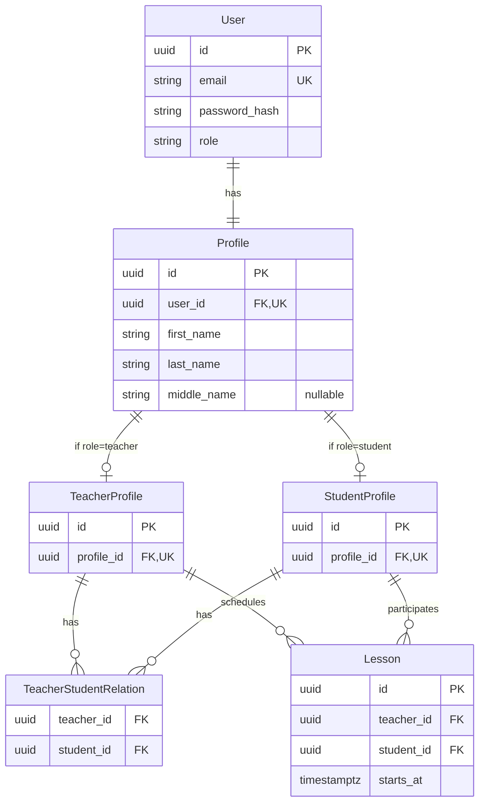

# Концептуальная модель данных

[К архитектуре](overview.md) · [BR](../requirements/business-rules.md) · [Контракты](../api/contracts/sprint-01.md)

## Подтверждённые понятия и связи

| Понятие | Требование Sprint 1 | Граница / примечание |
| --- | --- | --- |
| User | Аутентифицируемая учётная запись с уникальным `id`, нормализованным уникальным `email`, `password_hash` и одной ролью `teacher` или `student` | Один User не совмещает несколько ролей в Sprint 1 |
| Profile | Общие данные человека: `first_name`, `last_name`, опциональный `middle_name`; имеет собственный `id` и связан ровно с одним User | `bio`, пользовательская timezone и другие расширенные сведения в Sprint 1 не входят |
| TeacherProfile | Ролевой профиль преподавателя с собственным `id`, связанный ровно с одним Profile | Существует только для User с ролью `teacher`; специфичные поля преподавателя могут появиться в будущих инкрементах |
| StudentProfile | Ролевой профиль ученика с собственным `id`, связанный ровно с одним Profile | Существует только для User с ролью `student`; специфичные поля ученика могут появиться в будущих инкрементах |
| Teacher–Student relation | Связывает TeacherProfile и StudentProfile и определяет доступность Student для сценария создания Lesson | Пользовательское управление связями не входит в Sprint 1 |
| Lesson | Связан ровно с одним TeacherProfile, одним StudentProfile и содержит обязательный `starts_at` | `duration` и `ends_at` в минимальную модель Sprint 1 не входят |

В пользовательских сценариях термины **Teacher** и **Student** обозначают пользователей соответствующих ролей. На уровне данных их доменные идентификаторы представлены `TeacherProfile.id` и `StudentProfile.id`.

Идентификаторы User, Profile, TeacherProfile и StudentProfile являются отдельными и не взаимозаменяемыми. В API поля `teacher_id` и `student_id` ссылаются соответственно на `TeacherProfile.id` и `StudentProfile.id`.

Каждый User в Sprint 1 имеет ровно один Profile и ровно один ролевой профиль, соответствующий `User.role`:

- `teacher` → TeacherProfile;
- `student` → StudentProfile.

Один Profile не может одновременно иметь TeacherProfile и StudentProfile в Sprint 1.

Teacher–Student relation является отношением многие-ко-многим: Teacher может быть связан с несколькими Student, а Student — с несколькими Teacher. Ограничение «один Teacher на Student» в Sprint 1 не вводится.

Mermaid ER показывает две условные связи Profile → TeacherProfile / StudentProfile отдельно и не выражает XOR между ними. Канонический инвариант BR-09 остаётся обязательным: у каждого User есть один Profile и ровно один ролевой профиль, соответствующий `User.role`; состояние без требуемого ролевого профиля либо одновременно с двумя ролевыми профилями недопустимо.

Связь User → Profile является one-to-one: `Profile.user_id` обязателен и уникален.

Связи Profile → TeacherProfile и Profile → StudentProfile также one-to-one по соответствующей роли: `TeacherProfile.profile_id` и `StudentProfile.profile_id` обязательны и уникальны.

Проверка согласованности `User.role` и типа ролевого профиля является системным инвариантом регистрации.

Teacher–Student relation представляет отношение многие-ко-многим. Пара `(teacher_id, student_id)` должна быть уникальной; отдельный продуктовый смысл дубликата связи отсутствует.

Lesson хранит прямые ссылки на TeacherProfile и StudentProfile. Наличие Teacher–Student relation проверяется при создании Lesson согласно BR-02, но Lesson не является дочерним объектом записи TeacherStudentRelation. Это позволяет сохранять факт запланированного Lesson независимо от возможных будущих изменений связи между Teacher и Student.

Подпись связи StudentProfile → Lesson означает участие Student в запланированном Lesson, а не подтверждённую посещаемость.

## Инженерный baseline хранения

- Идентификаторы User, Profile, TeacherProfile, StudentProfile и Lesson — серверные UUID. В JSON они передаются строками. Frontend не вычисляет доменные идентификаторы из User ID.

- Минимальная схема User содержит:
  - `id`;
  - нормализованный уникальный `email`;
  - `password_hash`;
  - `role`.

- `email` хранится в нормализованном виде согласно BR-10. На уровне хранения должна обеспечиваться уникальность нормализованного значения.

- `role` допускает только значения `teacher` и `student`. Конкретный PostgreSQL-механизм ограничения (`ENUM`, `CHECK` или эквивалентный вариант) определяется при реализации и не меняет доменную семантику.

- Минимальная схема Profile содержит:
  - `id`;
  - обязательный уникальный `user_id`;
  - обязательный `first_name`;
  - обязательный `last_name`;
  - опциональный nullable `middle_name`.

- `first_name` и `last_name` сохраняются после удаления внешних пробелов и после trim должны оставаться непустыми согласно BR-10.

- `middle_name` опционален. Если значение передано, внешние пробелы удаляются; пустое после trim значение нормализуется в `null`.

- Минимальная схема TeacherProfile содержит:
  - `id`;
  - обязательный уникальный `profile_id`.

- Минимальная схема StudentProfile содержит:
  - `id`;
  - обязательный уникальный `profile_id`.

- В Sprint 1 TeacherProfile и StudentProfile не содержат дополнительных обязательных полей. Они фиксируют отдельные доменные идентификаторы ролей и являются точкой расширения для ролевых данных будущих инкрементов.

- Регистрация должна атомарно создавать User, Profile и ровно один соответствующий ролевой профиль. Частичное состояние, при котором отсутствует Profile / требуемый TeacherProfile или StudentProfile, создан ролевой профиль несоответствующей роли либо для одного Profile существуют оба ролевых профиля, не считается допустимым результатом регистрации.

- Для Teacher–Student relation используются внешние ключи `teacher_id → TeacherProfile.id` и `student_id → StudentProfile.id`; обеспечивается уникальность пары `(teacher_id, student_id)`. Конкретный способ задания ключа — составной primary key либо отдельный surrogate key с unique constraint — является техническим выбором реализации. Ограничение «один Teacher на Student» не вводится.

- Минимальная схема Lesson содержит:
  - `id`;
  - обязательный `teacher_id`;
  - обязательный `student_id`;
  - обязательный `starts_at`.

- `teacher_id` Lesson является внешним ключом на `TeacherProfile.id`, `student_id` — на `StudentProfile.id`. Teacher–Student relation проверяется в момент создания Lesson согласно BR-02, но не используется как родительская запись для Lesson.

- `starts_at` хранится в PostgreSQL как `timestamp with time zone` (`timestamptz`). На границе API используются timezone-aware значения; Backend сравнивает абсолютные моменты и возвращает их в UTC согласно [API conventions](../api/conventions.md#даты-и-время).

- PostgreSQL хранит абсолютный момент времени, а не исходное название timezone браузера или первоначальный offset. Отдельная пользовательская timezone в Sprint 1 не хранится.

- `bio`, аватар, предметы, контакты и другие расширенные Profile / TeacherProfile / StudentProfile данные без отдельного требования в Sprint 1 не добавляются.

- SQLAlchemy-модели являются persistence-моделью и не определяют публичный API DTO.

- Открытый пароль в БД не хранится. User содержит только безопасный `password_hash`; конкретный hashing-механизм определяется I-01.

Изменения схемы Sprint 1 оформляются Alembic-миграциями в соответствующих задачах. F-05 подготавливает механизм работы с PostgreSQL / SQLAlchemy / Alembic; F-06 добавляет User, Profile, TeacherProfile, StudentProfile и их связи; реализация US-01 добавляет Lesson.

Не добавлять в схему без отдельного требования посещаемость, homework, статусы Lesson, цены, отдельные названия Lesson, длительность, `ends_at`, пользовательскую timezone и другие поля будущих инкрементов.

## Демонстрационные данные и изменения

F-06 подготавливает воспроизводимый синтетический базовый набор demo data:

- 1 Teacher;
- не менее 3 Students;
- соответствующие им User, Profile и ролевые TeacherProfile / StudentProfile с корректными ролями;
- Teacher–Student relations, позволяющие проверить как связанную, так и несвязанную пару.

Для demo data не используются реальные персональные данные.

Lesson не является обязательной частью базового seed F-06, поскольку модель Lesson появляется в рамках US-01.

После появления Lesson соответствующие User Story и QA могут добавлять отдельные demo / test fixtures, необходимые для проверки бизнес-правил, в том числе:

- Lesson до, ровно на и после контрольного `now`;
- несколько Lesson с одинаковым `starts_at`;
- Lesson на границах календарного диапазона `from` / `to`;
- Lesson разных Teacher / Student для проверки изоляции пользовательского контекста.

I-04 определяет конкретный User / Profile-набор, распределение Teacher–Student relations и дополнительные Lesson / test fixtures сверх базового объёма F-06.

Наличие Teacher–Student relations в seed / fixtures не добавляет пользовательский сценарий создания, изменения или удаления этих связей.

Изменения схемы сначала отражаются в модели данных и, если они влияют на внешний обмен, в API-контрактах. Затем изменение оформляется соответствующей технической задачей и Alembic-миграцией согласно [change management](../process/change-management.md).

Техническая семантика хранения даты и времени основана на PostgreSQL `timestamp with time zone`; справочный источник: [PostgreSQL — Date/Time Types](https://www.postgresql.org/docs/current/datatype-datetime.html).
