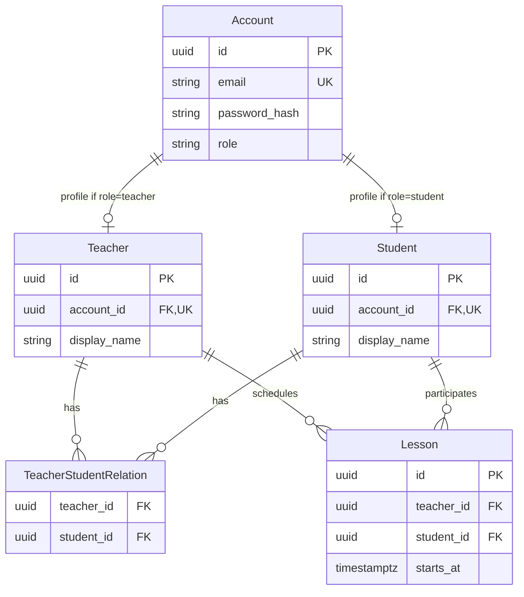

# Концептуальная модель данных

[К архитектуре](overview.md) · [BR](../requirements/business-rules.md) · [Контракты](../api/contracts/sprint-01.md)

## Подтверждённые понятия и связи

| Понятие | Требование Sprint 1 | Граница / примечание |
| --- | --- | --- |
| Account | Аутентифицируемая учётная запись с уникальным `id`, нормализованным уникальным `email`, `password_hash` и одной ролью `teacher` или `student` | Один Account не совмещает несколько ролей в Sprint 1 |
| Teacher | Доменный профиль преподавателя с собственным `id` и обязательным `display_name` | Связан ровно с одним Account роли `teacher` |
| Student | Доменный профиль ученика с собственным `id` и обязательным `display_name` | Связан ровно с одним Account роли `student` |
| Teacher–Student relation | Связывает Teacher и Student и определяет доступность Student для сценария создания Lesson | Пользовательское управление связями не входит в Sprint 1 |
| Lesson | Связан ровно с одним Teacher, одним Student и содержит обязательный `starts_at` | `duration` и `ends_at` в минимальную модель Sprint 1 не входят |

Идентификаторы Account, Teacher и Student являются отдельными и не взаимозаменяемыми.

Каждый Account в Sprint 1 имеет ровно одну роль и ровно один соответствующий доменный профиль: Teacher для роли `teacher` или Student для роли `student`.

Один Teacher или Student не может быть связан с несколькими Account.

Teacher–Student relation является отношением многие-ко-многим: Teacher может быть связан с несколькими Student, а Student — с несколькими Teacher. Ограничение «один Teacher на Student» в Sprint 1 не вводится.

Связь Account с доменным профилем является one-to-one: `Teacher.account_id` и `Student.account_id` обязательны для соответствующего профиля и уникальны.

Для каждого Account должен существовать ровно один профиль, соответствующий его `role`:

- `teacher` → Teacher;
- `student` → Student.

Одновременное наличие Teacher и Student для одного Account в Sprint 1 не допускается. Проверка согласованности `Account.role` и типа профиля является системным инвариантом регистрации.

Teacher–Student relation представляет отношение многие-ко-многим. Пара `(teacher_id, student_id)` должна быть уникальной; отдельный продуктовый смысл дубликата связи отсутствует.

Lesson хранит прямые ссылки на Teacher и Student. Наличие Teacher–Student relation проверяется при создании Lesson согласно BR-02, но Lesson не является дочерним объектом записи TeacherStudentRelation. Это позволяет сохранять факт запланированного Lesson независимо от возможных будущих изменений связи между Teacher и Student.

Подпись связи Student → Lesson означает участие Student в запланированном Lesson, а не подтверждённую посещаемость.

## Инженерный baseline хранения

- Идентификаторы Account, Teacher, Student и Lesson — серверные UUID. В JSON они передаются строками. Frontend не вычисляет доменные идентификаторы из Account ID.

- Минимальная схема Account содержит:
  - `id`;
  - нормализованный уникальный `email`;
  - `password_hash`;
  - `role`.

- `email` хранится в нормализованном виде согласно BR-10. На уровне хранения должна обеспечиваться уникальность нормализованного значения.

- `role` допускает только значения `teacher` и `student`. Конкретный PostgreSQL-механизм ограничения (`ENUM`, `CHECK` или эквивалентный вариант) определяется при реализации и не меняет доменную семантику.

- Минимальная схема Teacher содержит:
  - `id`;
  - обязательный уникальный `account_id`;
  - обязательный `display_name`.

- Минимальная схема Student содержит:
  - `id`;
  - обязательный уникальный `account_id`;
  - обязательный `display_name`.

- `display_name` сохраняется после удаления внешних пробелов и не может быть пустым согласно BR-10.

- Регистрация должна атомарно создавать Account и ровно один соответствующий доменный профиль. Частичное состояние, при котором Account создан без требуемого Teacher / Student или создан профиль несоответствующей роли, не считается допустимым результатом регистрации.

- Для Teacher–Student relation используются внешние ключи на Teacher и Student и обеспечивается уникальность пары `(teacher_id, student_id)`. Конкретный способ задания ключа — составной primary key либо отдельный surrogate key с unique constraint — является техническим выбором реализации. Ограничение «один Teacher на Student» не вводится.

- Минимальная схема Lesson содержит:
  - `id`;
  - обязательный `teacher_id`;
  - обязательный `student_id`;
  - обязательный `starts_at`.

- `teacher_id` и `student_id` Lesson являются внешними ключами на соответствующие доменные сущности. Teacher–Student relation проверяется в момент создания Lesson согласно BR-02, но не используется как родительская запись для Lesson.

- `starts_at` хранится в PostgreSQL как `timestamp with time zone` (`timestamptz`). На границе API используются timezone-aware значения; Backend сравнивает абсолютные моменты и возвращает их в UTC согласно [API conventions](../api/conventions.md#даты-и-время).

- PostgreSQL хранит абсолютный момент времени, а не исходное название timezone браузера или первоначальный offset. Отдельная пользовательская timezone в Sprint 1 не хранится.

- SQLAlchemy-модели являются persistence-моделью и не определяют публичный API DTO.

- Открытый пароль в БД не хранится. Account содержит только безопасный `password_hash`; конкретный hashing-механизм определяется I-01.

Изменения схемы Sprint 1 оформляются Alembic-миграциями в соответствующих задачах. F-05 подготавливает механизм работы с PostgreSQL / SQLAlchemy / Alembic; F-06 добавляет Account, Teacher, Student и их связи; реализация US-01 добавляет Lesson.

Не добавлять в схему без отдельного требования посещаемость, homework, статусы Lesson, цены, отдельные названия Lesson, длительность, `ends_at`, пользовательскую timezone и другие поля будущих инкрементов.

## Демонстрационные данные и изменения

F-06 подготавливает воспроизводимый синтетический базовый набор demo data:

- 1 Teacher;
- не менее 3 Students;
- соответствующие им Account с корректными ролями и доменными профилями;
- Teacher–Student relations, позволяющие проверить как связанную, так и несвязанную пару.

Для demo data не используются реальные персональные данные.

Lesson не является обязательной частью базового seed F-06, поскольку модель Lesson появляется в рамках US-01.

После появления Lesson соответствующие User Story и QA могут добавлять отдельные demo / test fixtures, необходимые для проверки бизнес-правил, в том числе:

- Lesson до, ровно на и после контрольного `now`;
- несколько Lesson с одинаковым `starts_at`;
- Lesson на границах календарного диапазона `from` / `to`;
- Lesson разных Teacher / Student для проверки изоляции пользовательского контекста.

I-04 определяет конкретный Account-набор, распределение Teacher–Student relations и дополнительные Lesson / test fixtures сверх базового объёма F-06.

Наличие Teacher–Student relations в seed / fixtures не добавляет пользовательский сценарий создания, изменения или удаления этих связей.

Изменения схемы сначала отражаются в модели данных и, если они влияют на внешний обмен, в API-контрактах. Затем изменение оформляется соответствующей технической задачей и Alembic-миграцией согласно [change management](../process/change-management.md).

Техническая семантика хранения даты и времени основана на PostgreSQL `timestamp with time zone`; справочный источник: [PostgreSQL — Date/Time Types](https://www.postgresql.org/docs/current/datatype-datetime.html).
