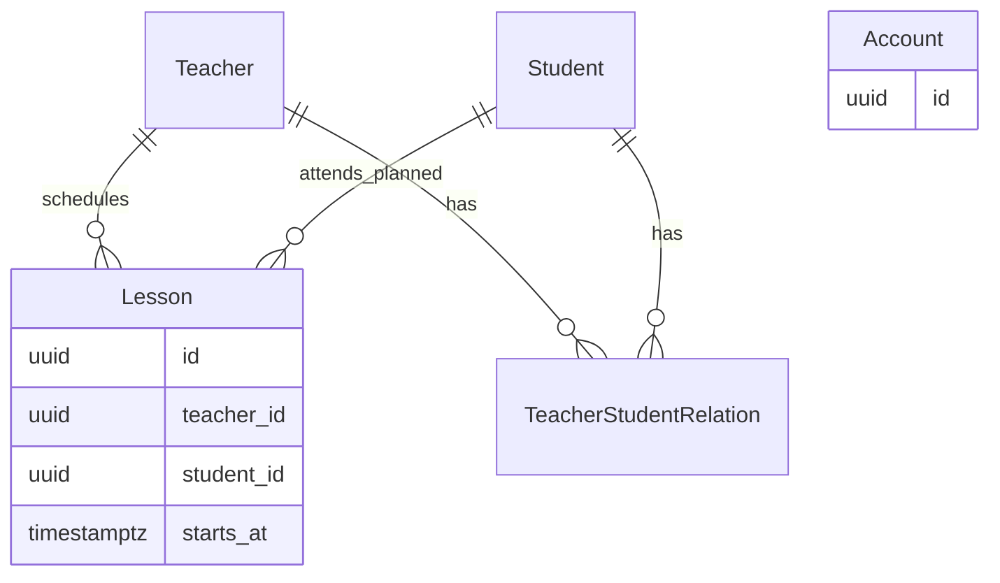

# Концептуальная модель данных

[К архитектуре](overview.md) · [BR](../requirements/business-rules.md) · [Контракты](../api/contracts/sprint-01.md)

## Подтверждённые понятия и связи

| Понятие | Требование Sprint 1 | Граница / примечание |
| --- | --- | --- |
| Account | Аутентифицируемая учётная запись с уникальным `id`, нормализованным уникальным `email`, `password_hash` и одной ролью `teacher` или `student` | Один Account не совмещает несколько ролей в Sprint 1 |
| Teacher | Доменный профиль преподавателя с собственным `id` и обязательным `display_name` | Связан ровно с одним Account роли `teacher` |
| Student | Доменный профиль ученика с собственным `id` и обязательным `display_name` | Связан ровно с одним Account роли `student` |
| Teacher–Student relation | Связывает Teacher и Student и определяет доступность Student для сценария создания Lesson | Пользовательское управление связями не входит в Sprint 1 |
| Lesson | Связан ровно с одним Teacher, одним Student и содержит обязательный `starts_at` | `duration` и `ends_at` в минимальную модель Sprint 1 не входят |

Идентификаторы Account, Teacher и Student являются отдельными и не взаимозаменяемыми.

Каждый Account в Sprint 1 имеет ровно одну роль и ровно один соответствующий доменный профиль: Teacher для роли `teacher` или Student для роли `student`.

Один Teacher или Student не может быть связан с несколькими Account.

Teacher–Student relation является отношением многие-ко-многим: Teacher может быть связан с несколькими Student, а Student — с несколькими Teacher. Ограничение «один Teacher на Student» в Sprint 1 не вводится.

Связующая сущность позволяет хранить известные пары, не устанавливая продуктовый предел количества Teacher или Student. Подпись `attends_planned` означает запланированную связь, не факт посещаемости. Account показан отдельно из-за Q-07.

## Инженерный baseline хранения

- Идентификаторы Account, Teacher, Student и Lesson — серверные UUID; JSON представляет их строками. Это технический выбор для единообразного обмена без раскрытия последовательности записей, а не доменное ограничение.
- Для Teacher–Student relation использовать внешние ключи на оба ресурса и уникальность пары: дубликат той же связи не имеет отдельного смысла. Не вводить ограничение «один Teacher на Student».
- Минимальные поля Lesson: `id`, `teacher_id`, `student_id`, `starts_at`; внешние ключи и обязательность связей отражают подтверждённый сценарий.
- Момент начала — PostgreSQL `timestamp with time zone` (`timestamptz`), timezone-aware значения на границе Python, нормализация / выдача UTC по [API](../api/conventions.md#даты-и-время).
- PostgreSQL сохраняет момент, а не исходное название зоны / offset пользователя. Хранить отдельную пользовательскую зону можно только при соответствующем требовании.
- SQLAlchemy-модели не являются публичными DTO. Пароль хранится только как проверяемый hash; политика Account требует Q-07 / Q-08.

Миграции выполняются Alembic в будущих задачах. F-05 может подготовить соединение, сессии, миграционный механизм и изолированную тестовую БД; окончательная схема Account зависит от PO. Не генерировать посещаемость, homework, статусы, цены, названия или длительность без утверждённого требования.

## Демонстрационные данные и изменения

F-06 готовит воспроизводимые синтетические Account / Teacher / Student, связанную и несвязанную пару, занятия до/на/после контрольного момента и границ диапазона. Конкретный набор и объём фиксирует исполнитель (I-04). Данные нужны для BR и QA; механизм создания пользовательских связей не добавляется этим seed-набором.

Изменения схемы сначала отражаются здесь и в API при влиянии на обмен, затем в технической задаче и будущей миграции по [change management](../process/change-management.md). Источник: [PostgreSQL — date/time](https://www.postgresql.org/docs/current/datatype-datetime.html).
