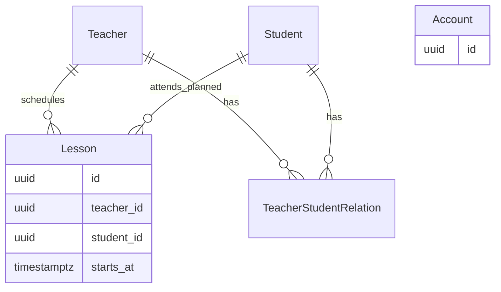

# Концептуальная модель данных

[К архитектуре](overview.md) · [BR](../requirements/business-rules.md) · [Контракты](../api/contracts/sprint-01.md)

## Подтверждённые понятия и связи

| Понятие | Известное требование | Что не определено этим документом |
| --- | --- | --- |
| Account | Представляет аутентифицируемую личность | Обязательные регистрационные поля, выдача / совмещение ролей: Q-07, Q-08 |
| Teacher | Контекст преподавателя определяется Backend из Account | Кардинальность Account–Teacher: Q-07 |
| Student | Контекст ученика определяется Backend из Account | Кардинальность Account–Student: Q-07 |
| Teacher–Student relation | Наличие связи проверяется для создания Lesson | Пользовательское управление связью: Q-06 |
| Lesson | Один Teacher, один Student, момент начала | Длительность и конец не входят в минимальную схему Sprint 1: Q-04 |

Наличие Account не означает наличие любого доменного ресурса. Идентификаторы Account, Teacher и Student не взаимозаменяемы. Диаграмма ниже намеренно не утверждает кардинальность Account–Role до решения PO.

Связующая сущность позволяет хранить известные пары, не устанавливая продуктовый предел количества Teacher или Student. Подпись `attends_planned` означает запланированную связь, не факт посещаемости. Account показан отдельно из-за Q-07.

## Инженерный baseline хранения

- Идентификаторы Account, Teacher, Student и Lesson — серверные UUID; JSON представляет их строками. Это технический выбор для единообразного обмена без раскрытия последовательности записей, а не доменное ограничение.
- Для Teacher–Student relation использовать внешние ключи на оба ресурса и уникальность пары: дубликат той же связи не имеет отдельного смысла. Не вводить ограничение «один Teacher на Student».
- Минимальные поля Lesson: `id`, `teacher_id`, `student_id`, `starts_at`; внешние ключи и обязательность связей отражают подтверждённый сценарий.
- Момент начала — PostgreSQL `timestamp with time zone` (`timestamptz`), timezone-aware значения на границе Python, нормализация / выдача UTC по [API](../api/conventions.md#даты-и-время).
- PostgreSQL сохраняет момент, а не исходное название зоны / offset пользователя. Хранить отдельную пользовательскую зону можно только при соответствующем требовании.
- SQLAlchemy-модели не являются публичными DTO. Пароль хранится только как проверяемый hash; политика Account требует Q-07 / Q-08.

Миграции выполняются Alembic в будущих задачах. F-05 может подготовить соединение, сессии, миграционный механизм и изолированную тестовую БД; окончательная схема Account зависит от PO. Не генерировать посещаемость, homework, статусы, цены, названия или длительность без утверждённого требования.

## Демонстрационные данные и изменения

F-06 готовит воспроизводимые синтетические Account / Teacher / Student, связанную и несвязанную пару, занятия до/на/после контрольного момента и границ диапазона. Конкретный набор и объём фиксирует исполнитель (I-04). Данные нужны для BR и QA; механизм создания пользовательских связей не добавляется этим seed-набором.

Изменения схемы сначала отражаются здесь и в API при влиянии на обмен, затем в технической задаче и будущей миграции по [change management](../process/change-management.md). Источник: [PostgreSQL — date/time](https://www.postgresql.org/docs/current/datatype-datetime.html).
