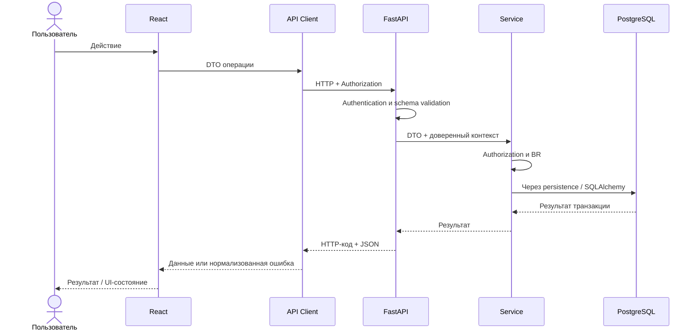

# Frontend ↔ Backend интеграция

[К архитектуре](overview.md) · [API](../api/conventions.md) · [Контракты Sprint 1](../api/contracts/sprint-01.md)

## Жизненный цикл

1. Product / Analyst фиксирует поведение, BR и AC; нерешённые продуктовые вопросы выделяются отдельно.
2. Backend и Frontend согласуют метод, путь, request/response DTO, ошибки и ограничения до параллельной реализации.
3. Контракт фиксируется в Git; оба участника ссылаются на одну редакцию. Контрактный мок допустим только для частей с определённой схемой.
4. Backend реализует endpoint, проверки и OpenAPI.
5. Frontend реализует API-layer function и mapping ошибок.
6. UI использует API-layer, отражая применимые состояния.
7. Участники интеграции проверяют реальный HTTP-запрос, а не только два независимых мока.
8. QA проверяет весь пользовательский поток; далее проводится применимая Product Acceptance.

Операция с блокирующим Q не объявляется готовой к реализации целиком: согласованные границы позволяют подготовительную работу, но не заменяют решение PO.

## Транспорт и локальное окружение

Base URL Backend задаётся в environment config Frontend. Имя переменной, порты и команды запуска выбираются F-04 / F-05 и документируются при реализации (I-03). UI получает готовый API-layer; URL внутри компонентов запрещён.

При разных локальных origins Backend разрешает согласованный origin Frontend в CORS, включая необходимые методы, `Content-Type` и `Authorization` для preflight. Origins задаются конфигурацией, без случайного wildcard. CORS — правило браузерного транспорта, не механизм авторизации. Не добавлять cookie credentials, если контракт использует только Bearer header.

Тела передаются по [JSON-соглашениям](../api/conventions.md). Header транспорта аутентификации описан в [authentication](../api/authentication.md). Пароли и токены исключаются из логов; пользовательский ID в запросе не переопределяет текущую личность.

## Успех, ошибки и время

API-layer проверяет HTTP-код и формат ответа. Empty collection — успешная пустая выборка. Ошибка HTTP обрабатывается по [error model](../api/errors.md); сетевой сбой без HTTP-ответа отображается отдельной локальной ошибкой. Не угадывать код из текста `message`.

Даты сериализуются до вызова HTTP по [единой семантике](../api/conventions.md#даты-и-время). Backend сравнивает абсолютные моменты. UI не восстанавливает timezone из форматированной подписи календаря.

Диаграмма показывает успешный маршрут. Ошибка проверки прекращает дальнейшую операцию; HTTP-ответ использует общий формат ошибок.

## Изменения и совместимость

Во время параллельной работы не удалять поля, не менять типы, смысл, обязательность, коды ошибок или временную семантику молча. Breaking change согласуют Backend, Frontend и PO, если меняется поведение, до merge. В связанной задаче / PR указываются затронутые потребители, порядок обновления и проверка интеграции.

Добавление необязательного response-поля обычно совместимо; новый обязательный request-параметр — breaking. До первого релиза допустимо синхронно обновить обе стороны в `/api/v1`, если это явно согласовано и интеграция проверена. Для внешних/выпущенных потребителей сначала определить миграцию или новую версию. Канонический порядок — [change management](../process/change-management.md).
