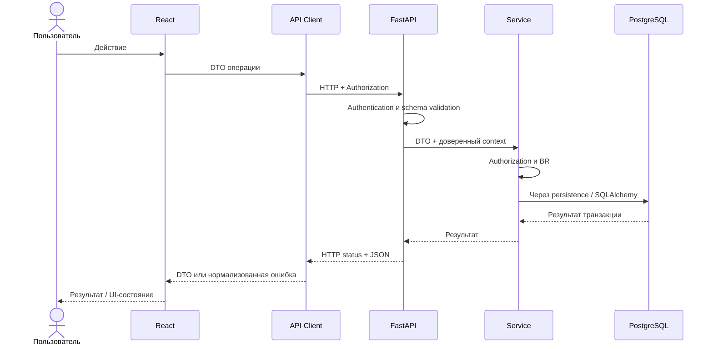

# Frontend ↔ Backend интеграция

[К архитектуре](overview.md) · [Backend](backend.md) · [Frontend](frontend.md) · [API conventions](../api/conventions.md) · [Authentication](../api/authentication.md) · [Ошибки](../api/errors.md) · [Контракты Sprint 1](../api/contracts/sprint-01.md)

## Жизненный цикл интеграции

1. PO / Analyst фиксирует требуемое поведение, BR и Acceptance Criteria.
2. Backend и Frontend до параллельной реализации согласуют:
   - метод и путь;
   - authentication / role requirements;
   - request DTO;
   - response DTO;
   - HTTP-коды и стабильные error codes;
   - временную семантику;
   - сортировку и другие значимые ограничения.
3. Согласованный контракт фиксируется в `docs/api/contracts/` и является общей спецификацией обеих сторон.
4. Contract mock допускается только для уже определённой части контракта и не считается доказательством интеграции.
5. Backend реализует endpoint, бизнес-проверки и runtime OpenAPI.
6. Frontend реализует API-layer и mapping DTO / ошибок.
7. Backend и Frontend проверяют реальный HTTP-обмен.
8. Runtime OpenAPI и фактические ответы сверяются с утверждённым контрактом.
9. QA проверяет пользовательский сценарий целиком; далее выполняется применимая Product Acceptance.

Если для сценария появляется блокирующее открытое решение, его статус фиксируется в реестре бизнес-правил. Подготовительная работа допустима только в уже определённых границах; предположение разработчика не заменяет решение PO.

## Транспорт и локальное окружение

Frontend получает Backend origin из environment config. API-layer самостоятельно добавляет `/api/v1` и конкретный resource path согласно [API conventions](../api/conventions.md).

Имя environment-переменной, локальные порты и команды запуска определяются при реализации F-04 / F-05 и фиксируются в документации окружения согласно I-03.

UI-компоненты не формируют Backend URL напрямую.

Если Frontend и Backend работают на разных origins, Backend CORS-конфигурация разрешает только необходимые origins, methods и headers, включая `Content-Type` и `Authorization`.

CORS является механизмом браузерного транспорта и не заменяет authentication / authorization.

В Sprint 1 защищённые запросы используют Bearer header. Cookie credentials не добавляются без отдельного изменения authentication contract.

Текущий пользователь определяется Backend из authentication context. Переданный клиентом User / Teacher / Student ID не переопределяет identity текущего пользователя.

Passwords, password hashes, реальные Bearer tokens и другие credentials не сохраняются в application logs, screenshots, публикуемом / сохраняемом QA evidence или bug reports. При диагностике runtime-запросов credential должен быть redacted перед сохранением или публикацией evidence.

## Семантика данных на границе

API-layer различает:

- успешный DTO;
- успешную пустую коллекцию `[]`;
- Backend ErrorDTO;
- transport failure без корректного Backend response;
- несовместимый response DTO.

Frontend не определяет программное поведение по тексту `message`; используются HTTP status и стабильный `error.code`.

UUID является техническим идентификатором. Если UI должен показать Teacher или Student пользователю, соответствующий API DTO должен содержать согласованное человекочитаемое представление, например `display_name`; Frontend не заменяет отсутствующее имя UUID.

Date-time передаётся как timezone-aware ISO 8601 значение с явным offset или `Z`.

Frontend интерпретирует ввод и отображает время в локальной timezone браузера, а Backend сравнивает абсолютные моменты.

Backend не обязан знать исходное название timezone браузера.

Для календаря Frontend формирует границы локальной календарной недели и отправляет абсолютные `from` / `to`; Backend применяет диапазон `[from, to)`.

Timezone не восстанавливается из форматированной подписи UI или текстового представления даты.

## Поток запроса

Диаграмма показывает успешный маршрут. При ошибке соответствующий слой прекращает дальнейшую операцию и возвращает согласованный результат через общую error model.

## Минимальная интеграционная проверка Sprint 1

До признания базовой Frontend ↔ Backend интеграции рабочей проверить как минимум:

- Frontend использует настроенный Backend origin и корректный `/api/v1`;
- CORS preflight проходит для фактически используемых методов и headers;
- защищённый запрос передаёт Bearer token через API-layer;
- Backend определяет текущий пользовательский context независимо от клиентских ID;
- успешный response разбирается Frontend согласно DTO;
- ErrorDTO корректно обрабатывается по HTTP status и `error.code`;
- `display_name` участников проходит через API и отображается в UI;
- timezone-aware date-time проходит Frontend → Backend → Frontend без изменения абсолютного момента;
- empty collection отображается как корректное пустое состояние;
- проверка выполняется реальным HTTP-запросом, а не только mock-ответами.

## Изменения и совместимость

Во время параллельной разработки нельзя молча изменять:

- method / path;
- authentication requirements;
- request / response fields;
- тип, обязательность или nullable-семантику поля;
- HTTP status;
- стабильный error code;
- сортировку;
- временную семантику;
- смысл существующего поля.

Новый обязательный request-параметр является breaking change.

Удаление response-поля, изменение его типа или смысла является breaking change для существующего потребителя.

Добавление необязательного response-поля потенциально совместимо, но должно проверяться против фактического API-layer и runtime validators потребителя; оно не считается автоматически безопасным.

Breaking change согласуется Backend, Frontend и PO, если затрагивает продуктовое поведение, до merge.

В связанной Technical Task / PR фиксируются:

- что меняется;
- какие потребители затронуты;
- порядок обновления сторон;
- какие контракты и документация обновлены;
- как проверена реальная интеграция.

До первого внешнего релиза Frontend и Backend допускается синхронно изменить контракт внутри `/api/v1`, если изменение явно согласовано, обе стороны обновлены вместе и интеграция проверена.

Runtime OpenAPI, отличающийся от утверждённого API-контракта без согласованного изменения документации, считается несогласованным изменением или дефектом.

Общий порядок изменений определяется [change management](../process/change-management.md).
