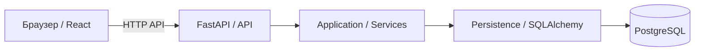

# Архитектура Takt

[К справочнику](../README.md) · [Решения](decisions/README.md)

## Базовая модель

Takt — модульный монолит: один Backend с разделением ответственности внутри приложения, React Frontend и PostgreSQL.

Отдельные сервисы, очереди и распределённая инфраструктура не вводятся без обоснованного требования.

Это целевая архитектура Sprint 1 и ближайшего инкремента. Документ описывает архитектурный baseline и не утверждает, что все перечисленные компоненты уже реализованы.

| Граница | Ответственность |
| --- | --- |
| Браузер / React | Действия пользователя, отображение данных и UI-состояний, предварительная валидация для UX |
| HTTP API / FastAPI | Внешние DTO, аутентификация, HTTP-коды, единый формат ошибок и transport-level validation |
| Application / Services | Авторитетные бизнес-проверки, авторизация над ресурсами, координация use case и границ атомарной операции |
| Persistence / SQLAlchemy | Запросы к данным, ORM-mapping, сохранение и техническая работа с транзакцией |
| PostgreSQL | Постоянное хранение, ссылочная целостность и согласованные ограничения данных |

UI не обращается к PostgreSQL напрямую. Сохранение и чтение данных проходят через Backend.

Frontend не является источником бизнес-правил или контроля доступа: применимые проверки выполняются Backend независимо от поведения клиента.

API является границей интеграции Frontend и Backend. SQLAlchemy-модели являются внутренними persistence-моделями и не передаются в UI как публичный контракт.

## Архитектурные принципы Sprint 1

- Backend является авторитетным источником бизнес-проверок и контроля доступа.
- Frontend может выполнять предварительную валидацию для UX, но она не заменяет Backend validation.
- API-контракты определяют внешний обмен между Frontend и Backend; SQLAlchemy-модели не являются публичными DTO.
- Идентичность и роль пользователя определяются из аутентифицированного Account, а не из произвольных идентификаторов, переданных клиентом.
- Изменения данных, образующие одну бизнес-операцию, должны выполняться атомарно.
- PostgreSQL является постоянным хранилищем данных Sprint 1.
- Существенные изменения архитектурного baseline должны быть явно согласованы и зафиксированы.

## Стек и зоны владения

| Область | Baseline |
| --- | --- |
| Backend | Python 3.12, FastAPI, Pydantic, SQLAlchemy, Alembic, pytest |
| Frontend | React, TypeScript |
| Database | PostgreSQL |
| Local infrastructure | Docker / Docker Compose |
| Repository / code review | Git / GitHub |
| Task management | Kaiten |
| UX/UI artifacts | Figma / Miro при использовании |

Конкретные версии зависимостей, кроме Python 3.12, фиксируются исполнителями и reviewers при инициализации соответствующих частей системы.

Документ не утверждает наличие ещё не реализованных компонентов, зависимостей или tooling.

Зоны команды определены в [обзоре продукта](../product/overview.md#ответственность-команды) и не дублируются здесь как отдельный источник истины.

В архитектурном контексте Максим отвечает за согласованность Backend / API / DB, Радик — за Frontend и техническую интеграцию с Backend. Вероника участвует в UX/UI, разработке и техническом уточнении по назначенным задачам. Михаил определяет продуктовые правила, Acceptance Criteria и выполняет Product Acceptance.

Конкретные исполнитель, reviewer, QA / Product Review, оценка и зависимости задачи определяются Sprint Planning и Kaiten.

## Рекомендуемая структура репозитория

F-02 закрепляет верхнеуровневую структуру `backend/`, `frontend/`, `docs/` и место общей локальной инфраструктуры в корне репозитория.

F-03 и F-04 создают Backend и Frontend как отдельные задачи. F-05 добавляет PostgreSQL, SQLAlchemy / Alembic и Docker Compose для воспроизводимого локального окружения.

Эта структура является планом организации проекта и не утверждает наличие файлов или компонентов до выполнения соответствующих задач.

Документация локального запуска, переменные окружения и команды проверки добавляются при реализации соответствующих частей системы. До этого в справочнике не фиксируются вымышленные команды или параметры окружения.

Подробнее:

- [Backend](backend.md);
- [Frontend](frontend.md);
- [Интеграция](integration.md);
- [Модель данных](data-model.md).

Существенное архитектурное решение, которое меняет этот baseline или создаёт долгосрочное техническое ограничение, фиксируется через ADR согласно [реестру решений](decisions/README.md).
