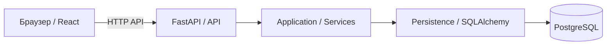

# Архитектура Takt

[К справочнику](../README.md) · [Решения](decisions/README.md)

## Базовая модель

Takt — модульный монолит: один Backend с разделением ответственности внутри приложения, React Frontend и PostgreSQL. Отдельные сервисы, очереди и распределённая инфраструктура не вводятся без обоснованного требования. Это целевая архитектура, приложение в рамках документации не создаётся.

| Граница | Ответственность |
| --- | --- |
| Браузер / React | Действия пользователя, отображение и UI-состояния, предварительная валидация для UX |
| HTTP API / FastAPI | DTO, аутентификация, HTTP-коды, единый формат ошибок |
| Services | Авторитетные бизнес-проверки, авторизация над ресурсами, координация операции |
| Persistence / SQLAlchemy | Запросы, отображение данных в ORM, транзакции |
| PostgreSQL | Хранение, ссылочная целостность и согласованные ограничения данных |

UI не обращается к PostgreSQL напрямую. Сохранение и чтение проходят через Backend. Frontend не является источником бизнес-правил или доступа; проверки на сервере выполняются независимо от клиента. API — граница интеграции, а ORM-модели не передаются в UI как контракт.

## Стек и зоны владения

Backend: Python 3.12, FastAPI, Pydantic, SQLAlchemy, Alembic, pytest. Frontend: React, TypeScript. Данные: PostgreSQL. Локальная инфраструктура: Docker / Docker Compose. Разработка: Git / GitHub, задачи: Kaiten, дизайн: Figma / Miro при использовании. Версии, кроме Python 3.12, фиксируются исполнителями и ревьюерами при инициализации; их текущая установка не заявляется.

Зоны команды — в [обзоре продукта](../product/overview.md#ответственность-команды). Максим отвечает за согласованность Backend / API / DB; Радик — Frontend и участие в интеграции; Вероника — UX/UI и назначенные работы; Михаил — продуктовые правила и приёмку. Назначения на конкретные задачи берутся из планирования.

## Рекомендуемая структура репозитория

F-02 закрепляет разделы `backend/`, `frontend/`, `docs/` и место конфигурации Docker Compose в корне. Это план организации, не утверждение о наличии этих файлов. F-03 / F-04 создают приложения отдельными задачами. Документация запуска, переменные окружения и проверки добавляются при их реализации в соответствующие разделы справочника, без вымышленных команд сейчас.

Подробнее: [Backend](backend.md), [Frontend](frontend.md), [интеграция](integration.md), [данные](data-model.md). Существенные отклонения от модели проходят ADR.
