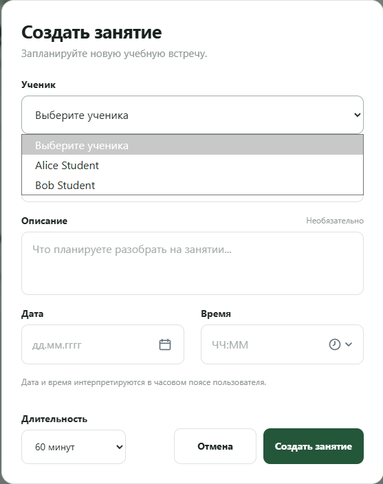
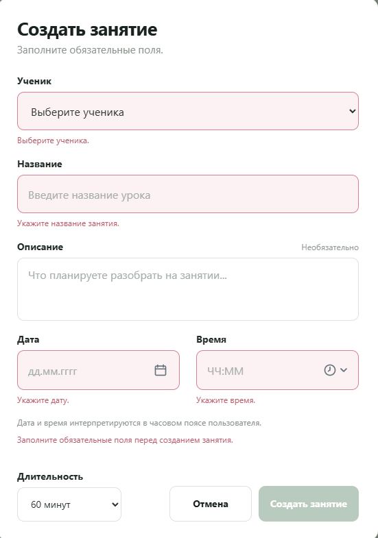
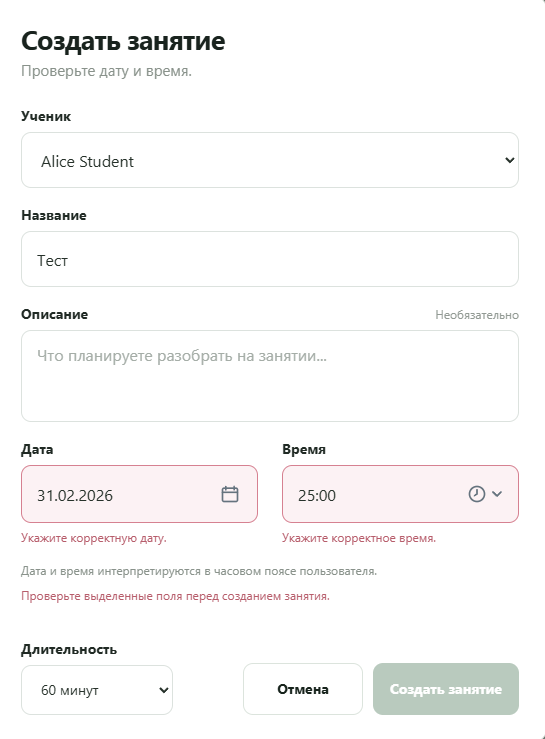
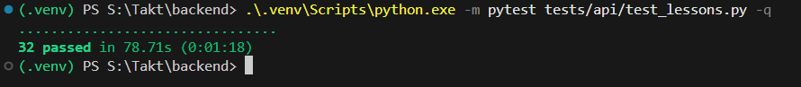
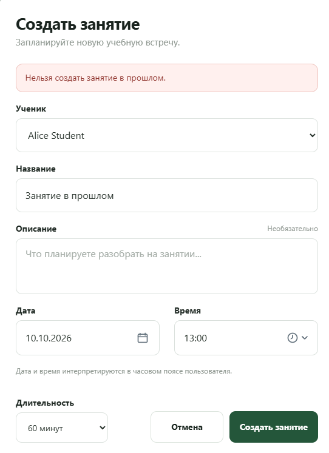
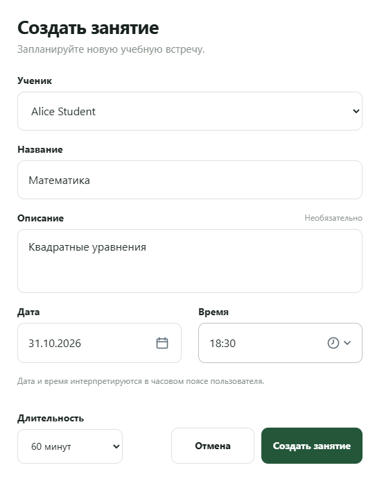
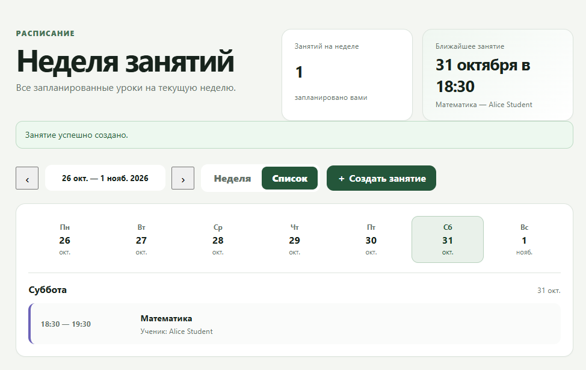

# US-01 — Acceptance Report

## Проверяемая версия

- Branch: `integration/sprint1`
- Commit: `bec4d1b40c0af0afdbcf0b3824891592800b2fb7`
- Environment: local Docker Compose
- Date: `2026-10-23`
- Backend automated tests: `32 passed`

После первоначальной приёмки выполнен дополнительный review реализации. В результате выявлен дефект обработки ошибки загрузки доступных Students, затрагивающий `AC-US01-10`. Статус отчёта актуализирован до повторной проверки исправления.

## Предусловия

Перед началом проверки:

- `postgres` — healthy;
- `backend` — healthy;
- `frontend` — healthy;
- выполнен development seed;
- авторизация под demo Teacher проходит успешно;
- раздел «Расписание» открывается.

Проверяемый пользователь:

```text
teacher@demo.example.com
Role: TEACHER
```

## Результаты Acceptance Criteria

| Acceptance Criterion | Status | Evidence | Комментарий |
| --- | --- | --- | --- |
| `AC-US01-01` — Доступные Students | 🟢 `PASS` |  | При успешной загрузке отображаются связанные Students `Alice Student` и `Bob Student`; несвязанный `Carol Student` отсутствует; пользователю показываются человекочитаемые имена. |
| `AC-US01-02` — Обязательные данные | 🟢 `PASS` |  | Без Student, названия, даты и времени Lesson не создаётся. Обязательные поля подсвечиваются и сопровождаются понятными validation messages. Описание остаётся необязательным. |
| `AC-US01-03` — Валидация данных | 🟢 `PASS` |  | UI отклоняет некорректные дату и время и не позволяет отправить форму. Ограничения `student_id`, длины title/description, timezone-aware datetime и положительной длительности дополнительно покрыты backend validation и automated API tests. |
| `AC-US01-04` — Trusted Teacher | 🟢 `PASS` |  | Backend определяет Teacher из authentication context. Передача произвольного `teacher_id` в request не позволяет выполнить операцию от имени другого Teacher. |
| `AC-US01-05` — Доступность Student | 🟢 `PASS` | <br> | UI показывает только связанных Students. Backend отклоняет отсутствующего, недоступного и Student с неактивной `Teacher ↔ Student` relation. |
| `AC-US01-06` — Время начала | 🟢 `PASS` |  | Попытка создать Lesson с датой и временем в прошлом отклонена Backend. Lesson не создан, форма остаётся открытой, пользователю отображается понятная ошибка. |
| `AC-US01-07` — Успешное создание | 🟢 `PASS` | <br> | Teacher успешно создал Lesson для доступного Student с названием, описанием, будущими датой и временем и длительностью 60 минут. |
| `AC-US01-08` — Результат создания | 🟢 `PASS` |  | После создания форма закрылась, отображено сообщение `Занятие успешно создано`, а Lesson появился в актуальном расписании с названием, Student и временем. |
| `AC-US01-09` — Authentication / Authorization | 🟢 `PASS` |  | Создание Lesson без authentication отклоняется. Student и ADMIN не могут выполнять Teacher-сценарий создания. |
| `AC-US01-10` — Ошибочные состояния | 🔴 `FAIL` | Code Review PR #11 | При ошибке запроса доступных Students Frontend использует fallback к пустому списку (`students.data ?? []`) и не отличает Backend/API error от корректного empty state. Требуется исправление и retest. |
| `AC-US01-11` — Конфликты расписания | 🟢 `PASS` |  | Automated API tests подтверждают, что создание двух Lesson на одинаковое время допускается в рамках US-01. |

## Automated Tests

Для проверки Backend-сценариев выполнено:

```text
python -m pytest tests/api/test_lessons.py -q
```

Результат:

```text
32 passed in 78.71s
```

Automated tests используются как дополнительное подтверждение Backend-критериев, которые нецелесообразно проверять только через пользовательский интерфейс.

## Обнаруженные дефекты

### DEF-US01-01 — ошибка загрузки Students маскируется под пустой список

При ошибке `GET /api/v1/teachers/me/students` Frontend не отображает отдельный error state и передаёт в форму пустой массив Students.

В результате пользователь не может отличить недоступность Backend/API от корректного отсутствия доступных Students.

- Затронутый критерий: `AC-US01-10`
- Статус дефекта: 🔴 `OPEN`
- Требуется: исправление разработчиками и targeted retest

## Итог

**Status: 🔴 `FAIL`**

`AC-US01-10` не выполнен для сценария ошибки загрузки доступных Students. Остальные проверенные критерии сохраняют подтверждённый результат.

После исправления требуется targeted retest `AC-US01-10`. При успешном retest итоговый статус US-01 может быть возвращён в 🟢 `PASS` без повторной проверки незатронутых критериев.

Приёмка выполнена по критериям из [`acceptance-criteria.md`](acceptance-criteria.md).
