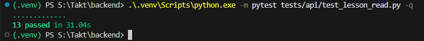
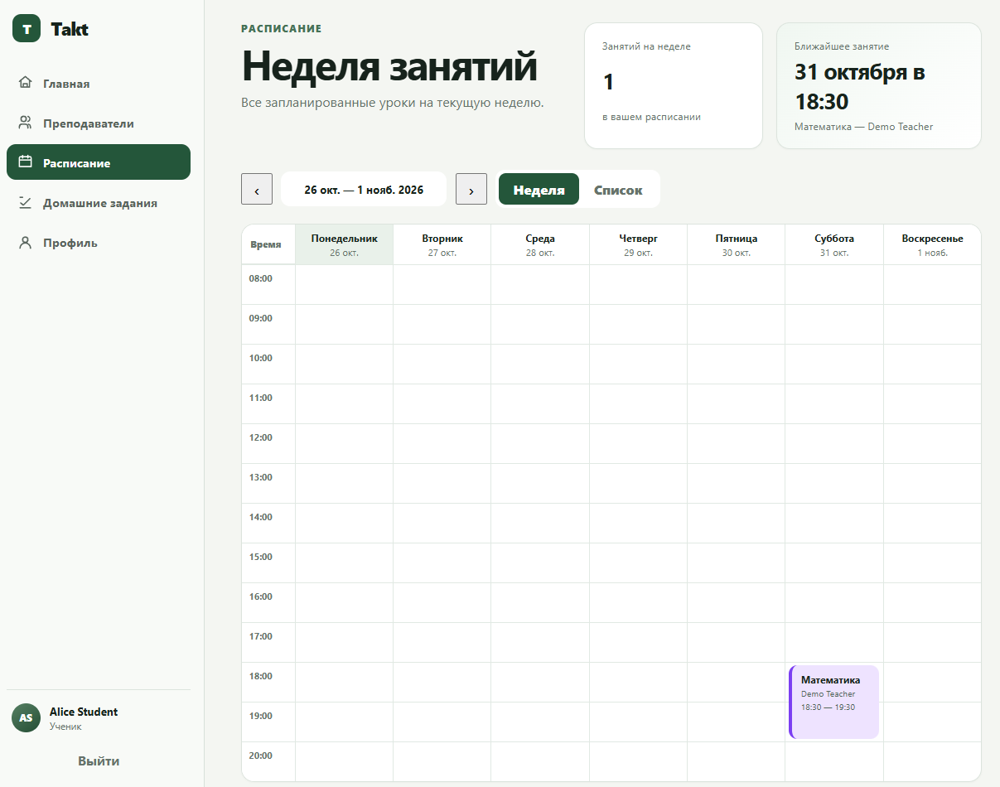
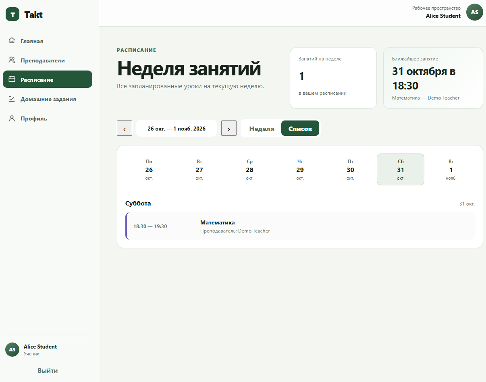
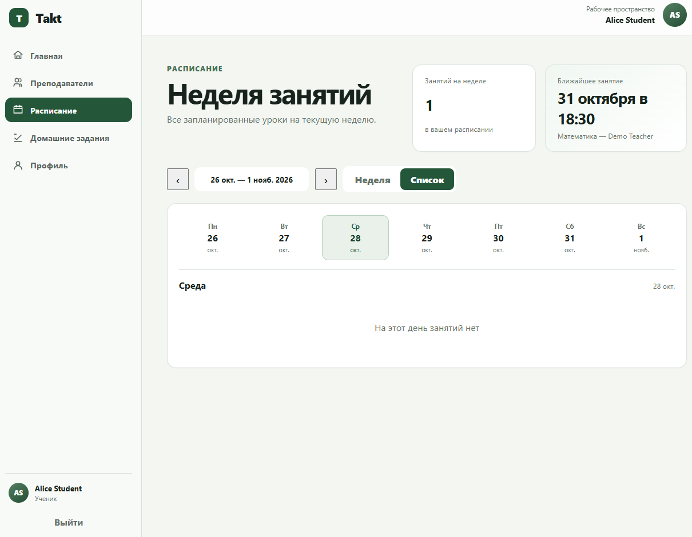
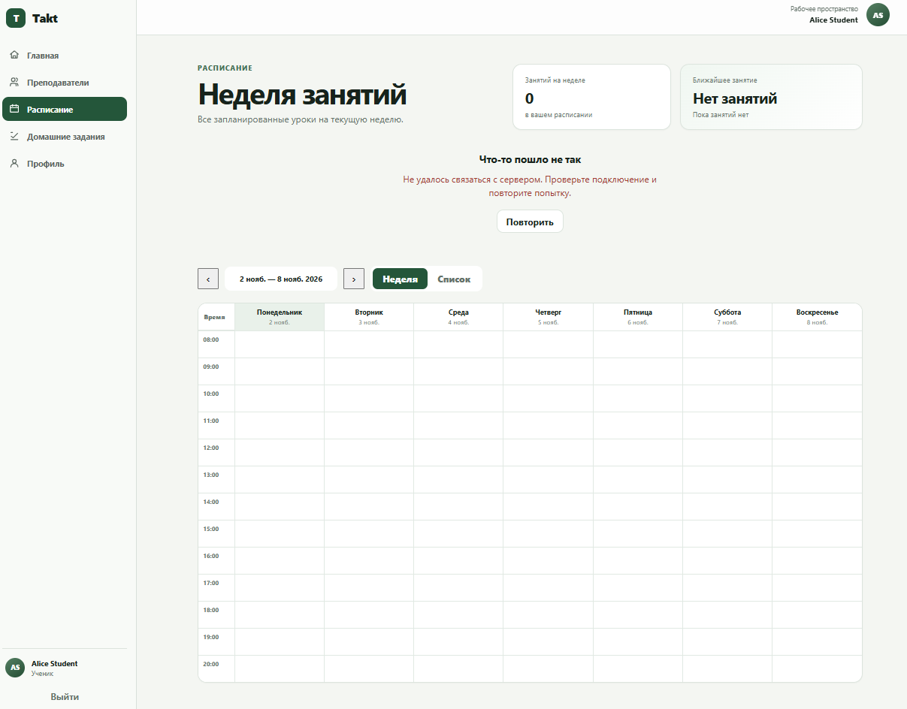
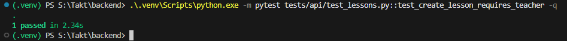

# US-02 — Acceptance Report

## Проверяемая версия

- Branch: `integration/sprint1`
- Commit: `38d1e3de59556c3b0f9fc861171e8bc18dbc3c0e`
- Environment: local Docker Compose
- Date: `2026-10-23`
- Backend automated tests: `13 passed` + `1 passed`

## Предусловия

Перед началом проверки:

- `postgres` — healthy;
- `backend` — healthy;
- `frontend` — healthy;
- выполнен development seed;
- в рамках US-01 создан будущий Lesson для `Alice Student`;
- приложение доступно через Frontend.

Проверяемый пользователь:

```text
student1@demo.example.com
Role: STUDENT
```

## Результаты Acceptance Criteria

| Acceptance Criterion | Status | Evidence | Комментарий |
| --- | --- | --- | --- |
| `AC-US02-01` — Расписание текущего Student | `PASS` |  | Automated API tests подтверждают, что Backend определяет текущего Student из authentication context и возвращает только доступные ему Lessons; занятия других Students в результат не попадают. |
| `AC-US02-02` — Предстоящие занятия | `PASS` |  | Student видит своё предстоящее занятие `Математика` на 31 октября 2026 года в 18:30 продолжительностью 60 минут. |
| `AC-US02-03` — Человекочитаемый Teacher | `PASS` |  | Teacher отображается как `Demo Teacher`; технический идентификатор не используется как пользовательская подпись преподавателя. |
| `AC-US02-04` — Фильтрация по периоду | `PASS` |  | Backend корректно фильтрует Lessons по заданному временному диапазону и отклоняет некорректные параметры периода. |
| `AC-US02-05` — Режим «Неделя» | `PASS` |  | В режиме `Неделя` отображаются дни недели и временная сетка; Lesson расположен в соответствии со своей датой и временем и содержит основные пользовательские данные. |
| `AC-US02-06` — Режим «Список» | `PASS` | <br> | В режиме `Список` Student может выбрать конкретный день. Для 31 октября отображается Lesson `Математика` с временем `18:30–19:30` и Teacher `Demo Teacher`; для дня без занятий отображается понятный empty state `На этот день занятий нет`. |
| `AC-US02-07` — Переключение недель | `PASS` |  | Пользователь может переключить отображаемую неделю; после перехода к периоду `26 окт. — 1 нояб. 2026` расписание обновляется и показывает Lesson соответствующего периода. |
| `AC-US02-08` — Пользовательские состояния | `PASS` | <br><br> | Проверены successful, empty и Backend/API error states. При недоступном Backend интерфейс явно сообщает об ошибке и предлагает повторить запрос, а не отображает её только как пустое расписание. Loading state предусмотрен интерфейсом при выполнении запроса расписания. |
| `AC-US02-09` — Ограничение возможностей Student | `PASS` | <br> | В интерфейсе Student отсутствует возможность создания Lesson. Automated API test подтверждает, что Student не может выполнить Teacher-сценарий создания. Изменение и отмена Lesson в рамках сценария просмотра недоступны; Backend ограничивает данные authentication context текущего пользователя. |

## Automated Tests

Для проверки чтения расписания, пользовательского scope и фильтрации выполнено:

```text
python -m pytest tests/api/test_lesson_read.py -q
```

Результат:

```text
13 passed in 31.04s
```

Дополнительно проверено ограничение создания Lesson для Student:

```text
python -m pytest tests/api/test_lessons.py::test_create_lesson_requires_teacher -q
```

Результат:

```text
1 passed in 2.34s
```

Automated tests используются как дополнительное подтверждение Backend-критериев, связанных с доступом текущего пользователя, фильтрацией расписания и ограничением возможностей Student.

## Обнаруженные дефекты

В рамках проверки Acceptance Criteria US-02 дефекты не зафиксированы.

Критические и блокирующие расхождения между документацией и фактическим поведением не обнаружены.

## Итог

**Status: `PASS`**

Все обязательные `AC-US02-01–AC-US02-09` выполнены.

Student видит собственное актуальное расписание, получает человекочитаемые данные Teacher, может использовать режимы `Неделя` и `Список`, переключать недели и корректно получает empty/error states. Данные других Students через сценарий просмотра не раскрываются, а Teacher-сценарий создания Lesson для Student недоступен.

Приёмка выполнена по критериям из [`acceptance-criteria.md`](acceptance-criteria.md).
