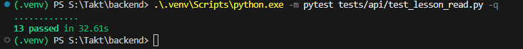
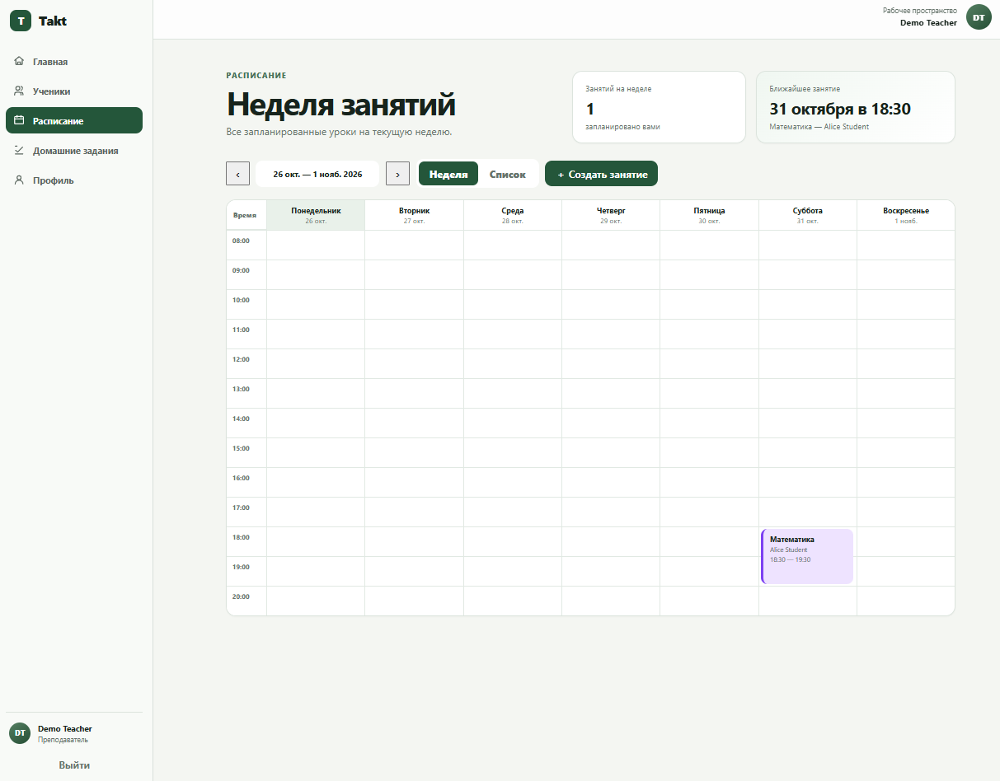
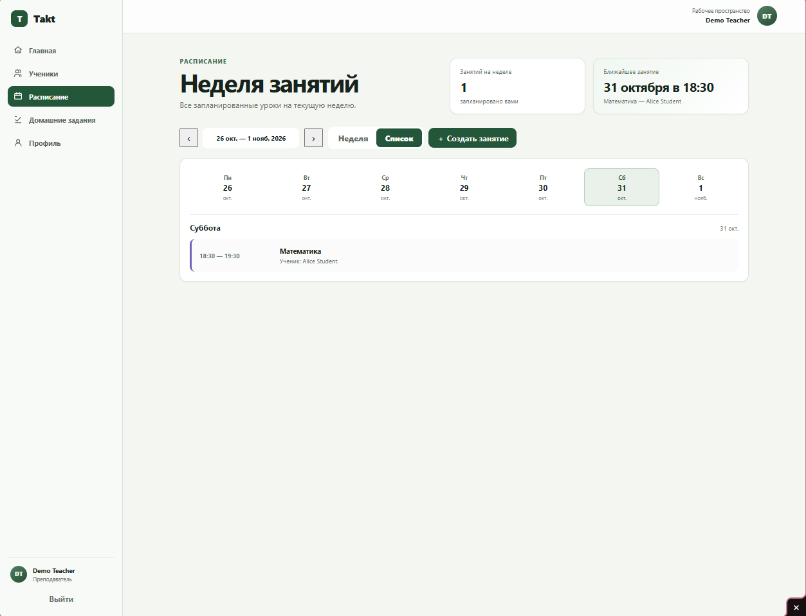
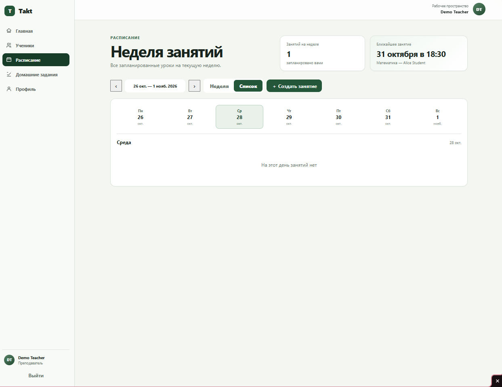
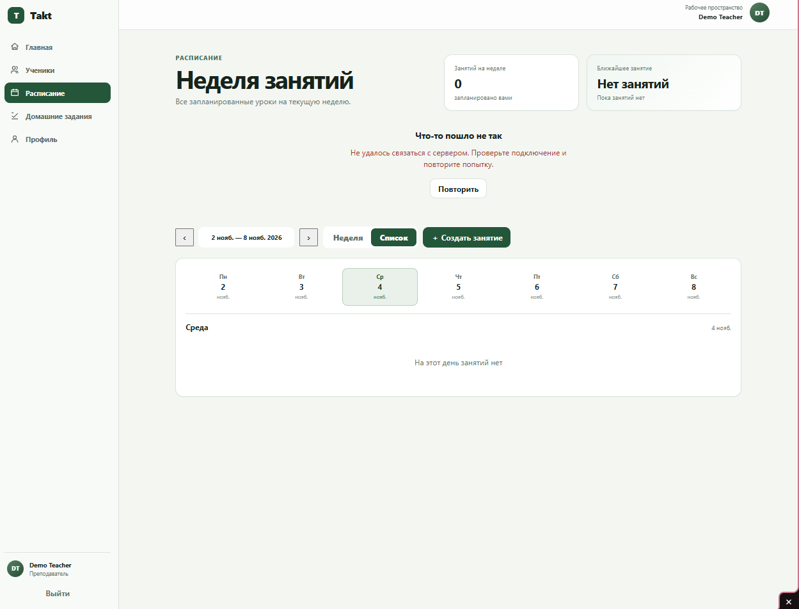

# US-03 — Acceptance Report

## Проверяемая версия

- Branch: `integration/sprint1`
- Commit: `f05f4a037758f209235db1721f795c7476c3cc97`
- Environment: local Docker Compose
- Date: `2026-10-23`
- Backend automated tests: `13 passed`

## Предусловия

Перед началом проверки:

- `postgres` — healthy;
- `backend` — healthy;
- `frontend` — healthy;
- выполнен development seed;
- в рамках US-01 создан будущий Lesson для `Alice Student`;
- приложение доступно через Frontend.

Проверяемый пользователь:

```text
teacher@demo.example.com
Role: TEACHER
```

## Результаты Acceptance Criteria

| Acceptance Criterion | Status | Evidence | Комментарий |
| --- | --- | --- | --- |
| `AC-US03-01` — Расписание текущего Teacher | `PASS` |  | Automated API tests подтверждают, что Backend определяет текущего Teacher из authentication context и возвращает только доступные ему Lessons; занятия других Teachers в результат не попадают. |
| `AC-US03-02` — Данные занятия | `PASS` |  | Для Lesson отображаются название `Математика`, Student `Alice Student`, дата и время начала `31 октября, 18:30`, а также длительность 60 минут (`18:30–19:30`). |
| `AC-US03-03` — Человекочитаемый Student | `PASS` |  | Student отображается как `Alice Student`; технический идентификатор не используется как пользовательская подпись. |
| `AC-US03-04` — Фильтрация по периоду | `PASS` |  | Backend корректно фильтрует Lessons по временному диапазону текущего Teacher и отклоняет некорректные параметры периода. |
| `AC-US03-05` — Режим «Неделя» | `PASS` |  | В режиме `Неделя` отображаются дни недели и временная сетка; Lesson расположен в соответствии со своей датой и временем и содержит основные пользовательские данные. |
| `AC-US03-06` — Режим «Список» | `PASS` | <br> | В режиме `Список` Teacher может выбрать конкретный день. Для 31 октября отображается Lesson `Математика` с временем `18:30–19:30` и Student `Alice Student`; для дня без занятий отображается понятный empty state `На этот день занятий нет`. |
| `AC-US03-07` — Переключение недель | `PASS` |  | Teacher может переключить отображаемую неделю; после перехода к периоду `26 окт. — 1 нояб. 2026` расписание обновляется и отображает Lesson соответствующего периода. |
| `AC-US03-08` — Пользовательские состояния | `PASS` | <br><br> | Проверены successful, empty и Backend/API error states. При недоступном Backend интерфейс явно сообщает об ошибке и предлагает повторить запрос, а не отображает её только как пустое расписание. Loading state предусмотрен интерфейсом при выполнении запроса расписания. |
| `AC-US03-09` — Доступ к чужому расписанию | `PASS` |  | Scope расписания определяется Backend на основании authentication context; клиент не может получить расписание другого Teacher простой подменой `teacher_id`. |
| `AC-US03-10` — Границы сценария | `PASS` | <br> | Просмотр расписания не предоставляет действий переноса, отмены, изменения статуса или изменения Teacher/Student существующего Lesson. Доступное действие создания нового Lesson относится к US-01 и не изменяет существующие занятия. |

## Automated Tests

Для проверки чтения расписания, Teacher scope и фильтрации выполнено:

```text
python -m pytest tests/api/test_lesson_read.py -q
```

Результат:

```text
13 passed in 32.61s
```

Automated tests используются как дополнительное подтверждение Backend-критериев, связанных с доступом текущего Teacher, фильтрацией расписания и изоляцией данных других пользователей.

## Обнаруженные дефекты

В рамках проверки Acceptance Criteria US-03 дефекты не зафиксированы.

Критические и блокирующие расхождения между документацией и фактическим поведением не обнаружены.

## Итог

**Status: `PASS`**

Все обязательные `AC-US03-01–AC-US03-10` выполнены.

Teacher видит собственное расписание за выбранный период, получает человекочитаемые данные Student, может использовать режимы `Неделя` и `Список`, переключать недели и корректно получает empty/error states. Расписание других Teachers через данный сценарий недоступно, а просмотр календаря не изменяет существующие Lessons.

Приёмка выполнена по критериям из [`acceptance-criteria.md`](acceptance-criteria.md).
